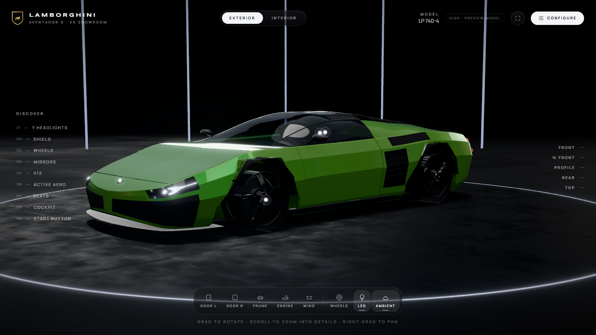
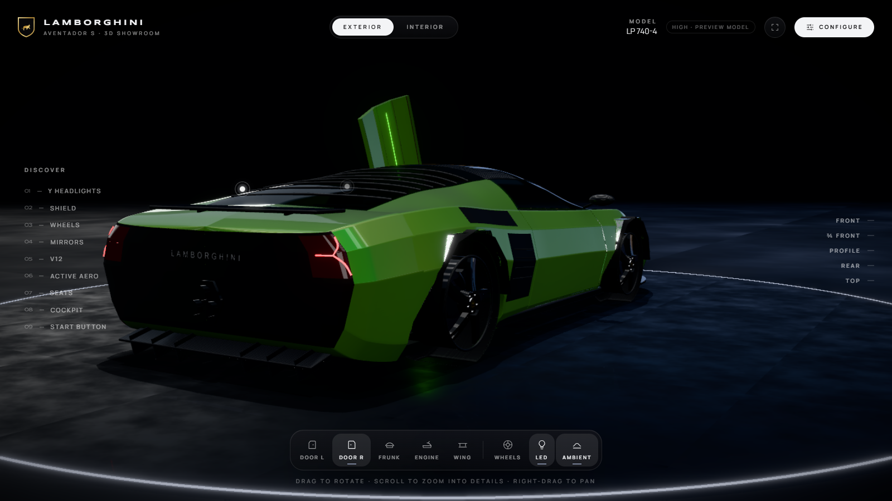
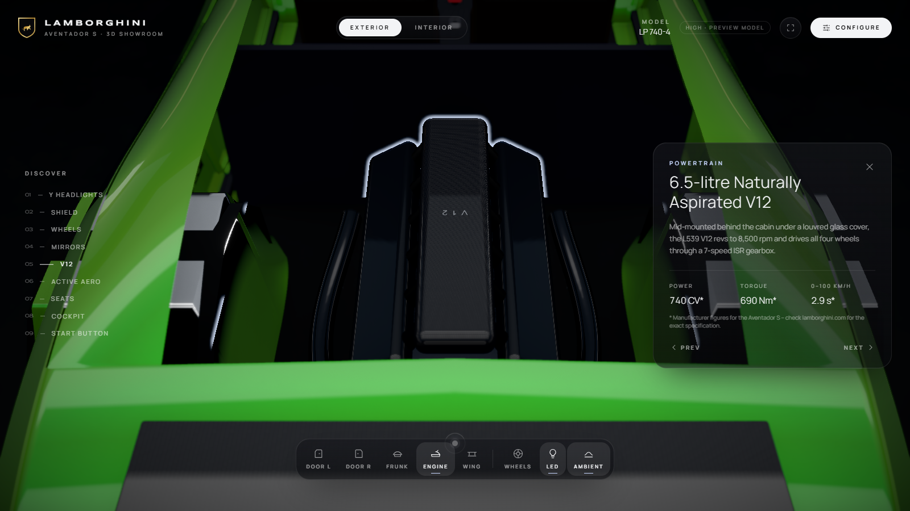
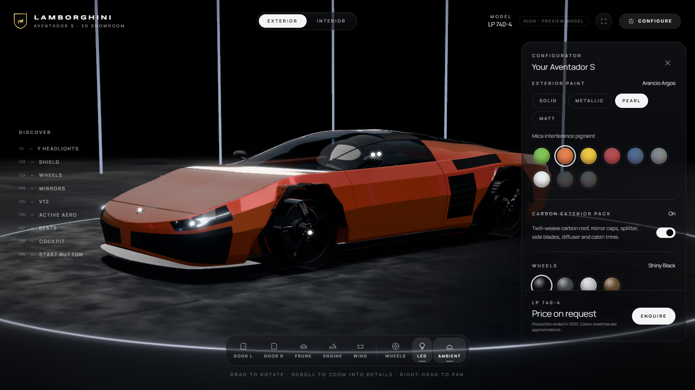
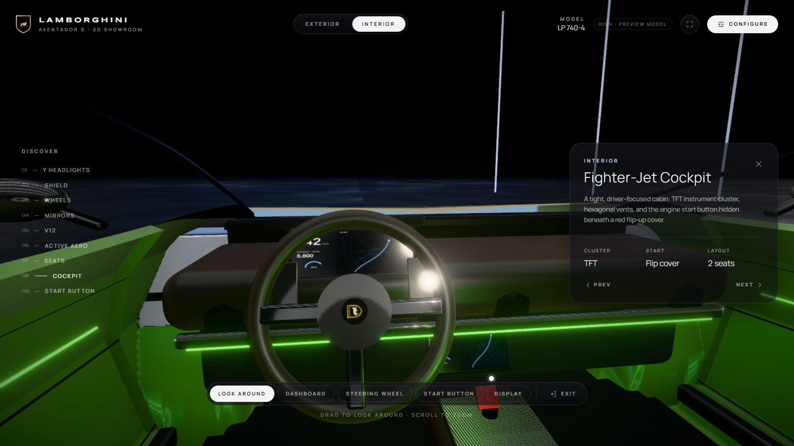
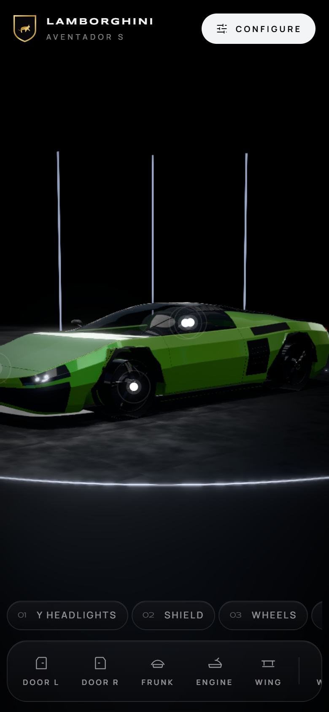

# Lamborghini Aventador S — 3D Showroom & Configurator

Showroom 3D thời gian thực trên trình duyệt cho **Lamborghini Aventador S (LP 740-4)**, phong cách configurator của các hãng xe cao cấp: camera cinematic, 9 điểm khám phá có highlight, đổi sơn / finish / carbon theo thời gian thực, cửa cắt kéo, nắp kính khoang V12, cánh gió chủ động, chế độ nội thất 360° và post-processing HDR.

Toàn bộ chiếc xe được **dựng bằng code** (procedural geometry), không cần file 3D. Khi có model GLB thật, chỉ cần thả vào `public/models/car.glb`, mọi tính năng vẫn hoạt động.



| Cửa cắt kéo | Focus V12 |
| --- | --- |
|  |  |
| **Configurator** | **Cockpit** |
|  |  |

<p align="center"></p>

---

## Mục lục

1. [Tính năng](#1-tính-năng)
2. [Công nghệ](#2-công-nghệ)
3. [Cài đặt & chạy](#3-cài-đặt--chạy)
4. [Điều khiển](#4-điều-khiển)
5. [Cấu trúc thư mục](#5-cấu-trúc-thư-mục)
6. [Kiến trúc & các thành phần chính](#6-kiến-trúc--các-thành-phần-chính)
7. [Xe procedural](#7-xe-procedural)
8. [Dùng model GLB của bạn](#8-dùng-model-glb-của-bạn)
9. [Tối ưu hiệu năng](#9-tối-ưu-hiệu-năng)
10. [SEO](#10-seo)
11. [Triển khai (deploy)](#11-triển-khai-deploy)
12. [Tuỳ biến nhanh](#12-tuỳ-biến-nhanh)
13. [Hạn chế đã biết](#13-hạn-chế-đã-biết)
14. [Nhãn hiệu & số liệu](#14-nhãn-hiệu--số-liệu)

---

## 1. Tính năng

**Ngoại thất & camera**
- Xoay 360°, zoom sâu vào chi tiết dưới con trỏ, damping mượt, chặn camera xuống dưới sàn.
- 5 góc preset (Front, ¾ Front, Profile, Rear, Top) với chuyển cảnh cinematic theo cung cầu.
- Intro: camera bay từ góc sau thấp ra góc ¾ trước trong khi đèn showroom bật dần.
- Tự xoay chậm sau 9 giây không thao tác.

**9 điểm khám phá (Discover)**
Y Headlights · Shield · Wheels · Mirrors · V12 · Active Aero · Seats · Cockpit · Start Button.
Mỗi điểm: camera bay tới → viền highlight + lấy nét (depth of field) → thẻ thông tin. Một số điểm tự mở bộ phận liên quan (V12 mở nắp kính động cơ, Active Aero nâng cánh gió, Seats mở cửa).

**Chuyển động** — cửa cắt kéo trái/phải, nắp cốp trước (frunk), nắp kính khoang động cơ, cánh gió nâng + nghiêng, xoay bánh, bật/tắt đèn LED và đèn ambient.

**Configurator**
- 9 màu sơn Lamborghini: Verde Mantis, Arancio Argos, Giallo Orion, Rosso Mars, Blu Nethuns, Grigio Telesto, Bianco Monocerus, Nero Aldebaran, Nero Nemesis.
- 4 finish: Solid / Metallic / Pearl / Matt, chuyển đổi mượt.
- Carbon exterior pack (mái, nắp gương, splitter, cánh gió, nan nắp động cơ).
- Màu mâm, màu kẹp phanh, màu da nội thất, màu đèn ambient.

**Nội thất** — chế độ nhìn 360° từ ghế lái, zoom quang học, các góc chi tiết: táp-lô, vô lăng, nút khởi động, màn hình.

**Hình ảnh** — IBL studio, PBR, clearcoat có micro-flake, kính khúc xạ, carbon anisotropic, sàn phản chiếu, bóng mềm + contact shadow, AO, bloom, tone mapping Khronos PBR Neutral.

**Hiệu năng & UX** — lazy loading, LOD, chất lượng tự thích ứng để giữ 60 fps, giao diện tối kiểu Apple, responsive (desktop, tablet, điện thoại).

---

## 2. Công nghệ

| Thư viện | Vai trò |
| --- | --- |
| [Next.js 15](https://nextjs.org) (App Router) | Framework, server components, metadata / OG |
| React 19 + TypeScript | UI |
| [React Three Fiber 9](https://r3f.docs.pmnd.rs) + [Three.js r186](https://threejs.org) | Render 3D |
| [Drei 10](https://drei.docs.pmnd.rs) | CameraControls, Environment, Lightformer, LOD, ContactShadows, MeshReflectorMaterial… |
| [@react-three/postprocessing 3](https://github.com/pmndrs/react-postprocessing) | N8AO, Bloom, DOF, Outline, ToneMapping, SMAA |
| [GSAP 3](https://gsap.com) + @gsap/react | Tween camera, vật liệu, bản lề, UI |
| [Zustand 5](https://zustand.docs.pmnd.rs) | State toàn cục (subscribe ngoài React) |
| [Tailwind CSS 4](https://tailwindcss.com) | Giao diện |
| gltf-transform (script) | Nén GLB: Draco, KTX2/WebP, tạo LOD |

---

## 3. Cài đặt & chạy

**Yêu cầu:** Node.js ≥ 20, trình duyệt hỗ trợ WebGL 2 (Chrome, Edge, Firefox, Safari 15+).

```bash
git clone https://github.com/DuongThanhPhat-09/my-car-show.git
cd my-car-show
npm install          # postinstall tự copy Draco + Basis decoder vào public/
npm run dev          # http://localhost:3000
```

Bản production:

```bash
npm run build
npm start            # http://localhost:3000
```

| Lệnh | Mô tả |
| --- | --- |
| `npm run dev` | Chạy môi trường phát triển |
| `npm run build` / `npm start` | Build và chạy production |
| `npm run typecheck` | Kiểm tra TypeScript |
| `npm run lint` | ESLint |
| `npm run optimize:model -- path/to/car.glb` | Nén GLB → `public/models/` (3 cấp LOD) |

**Tham số URL:** `?quality=high|medium|low` khoá tier chất lượng (dùng khi demo, chụp màn hình, kiểm thử trên máy yếu). Không có tham số thì tier được chọn tự động theo thiết bị và tự hạ khi FPS giảm.

**Biến môi trường (tuỳ chọn):**

| Biến | Mặc định | Dùng cho |
| --- | --- | --- |
| `NEXT_PUBLIC_SITE_URL` | `http://localhost:3000` | URL tuyệt đối trong metadata, Open Graph, sitemap, robots |

---

## 4. Điều khiển

| Thao tác | Desktop | Cảm ứng |
| --- | --- | --- |
| Xoay quanh xe | Kéo chuột trái | Kéo 1 ngón |
| Zoom vào chi tiết | Cuộn chuột (zoom về phía con trỏ) | Chụm 2 ngón |
| Di chuyển (pan) | Kéo chuột phải | Kéo 2 ngón |
| Đóng thẻ thông tin / panel | `Esc` | Nút ✕ |

- **Thanh dưới:** Door L · Door R · Frunk · Engine · Wing · Wheels · LED · Ambient.
- **Cột trái (Discover):** 9 điểm khám phá; cũng có thể bấm các chấm hotspot trên xe.
- **Cột phải:** góc nhìn preset.
- **Trên cùng:** chuyển Exterior / Interior, toàn màn hình, mở Configure.

---

## 5. Cấu trúc thư mục

Tổ chức theo **feature**: mỗi thư mục trong `features/` chứa component, hook và logic của một mảng chức năng.

```
├── docs/screenshots/            # Ảnh dùng trong README
├── public/                      # (draco/, basis/ được sinh khi npm install; models/, hdri/ tuỳ chọn)
├── scripts/
│   ├── copy-decoders.mjs        # postinstall: copy decoder Draco + Basis từ node_modules
│   └── optimize-model.mjs       # Pipeline gltf-transform: Draco, KTX2/WebP, 3 cấp LOD
└── src/
    ├── app/                         # Server components + SEO
    │   ├── layout.tsx               # Metadata, Open Graph, Twitter, viewport, fonts
    │   ├── page.tsx                 # Nội dung crawlable (sr-only) + JSON-LD schema.org/Car
    │   ├── opengraph-image.tsx      # Ảnh OG sinh bằng next/og
    │   └── robots.ts · sitemap.ts · icon.svg · globals.css
    ├── config/site.ts               # Tên, mô tả, thông số dùng cho SEO
    ├── store/useShowroomStore.ts    # Zustand: phase, mode, focus, configuration, parts, quality, camera API
    ├── lib/
    │   ├── math/monotoneCubic.ts    # Spline đơn điệu (profile thân xe không gợn sóng)
    │   ├── three/parametricPatch.ts # Bề mặt tham số → BufferGeometry, normal giải tích
    │   ├── three/proceduralTextures.ts  # Carbon twill + anisotropy, da, lốp, đĩa phanh, màn hình, khiên…
    │   └── device/detectQuality.ts  # Chọn tier ban đầu (không kéo three.js vào bundle đầu)
    ├── components/
    │   ├── ui/                      # Icon, IconButton, Pill, Swatch, Toggle
    │   └── brand/LamborghiniMark.tsx    # Khiên SVG cho TopBar / màn hình tải
    └── features/
        ├── experience/              # ShowroomExperience (client root) · Scene (Canvas) · Overlay · TopBar
        ├── car/
        │   ├── config/car.config.ts # ★ Contract model: URL, LOD, bản lề, slot material, focus points, camera
        │   ├── components/          # Car · GlbCar · ProceduralCar · CarAssembly · CarLights · ShaderWarmup
        │   ├── rig/                 # buildRig (pivot) · resolveHandles (slot) · carRegistry · applyConfiguration
        │   ├── materials/           # paintMaterial (flake + clearcoat) · materialLibrary
        │   ├── procedural/          # profile · buildBody · buildWheels · buildInterior · buildDetails · helpers
        │   └── hooks/useAssetAvailability.ts
        ├── camera/                  # CameraRig: fly-to, intro, idle orbit, interior look mode
        ├── focus/                   # FocusHotspots (3D) · FocusCard · FocusNav · useFocusActions
        ├── configurator/            # ConfiguratorPanel · ConfiguratorSync · options (catalogue)
        ├── controls/                # ActionDock (cửa, frunk, động cơ, cánh gió, bánh, LED) · ViewPresets
        ├── interior/                # InteriorControls
        ├── stage/                   # StudioEnvironment · StudioLights · Showroom · Effects · QualityManager
        └── loading/                 # LoadingScreen · ProgressReporter
```

---

## 6. Kiến trúc & các thành phần chính

### Luồng trải nghiệm
`page.tsx` (server) render nội dung SEO → `ShowroomExperience` (client) kiểm tra WebGL 2 và chọn tier → `Scene` được lazy-load bằng `next/dynamic`. `LoadingScreen` hiển thị tiến độ thật (90 % tải asset + 10 % biên dịch shader) → khi `sceneReady` thì mở "rèm", chuyển `phase: "intro"` → `CameraRig` chạy intro → `phase: "ready"`, UI xuất hiện lần lượt.

### State (`store/useShowroomStore.ts`)
Một store Zustand với `subscribeWithSelector`. Các phần 3D (vật liệu, bản lề, đèn, hotspot) **subscribe trực tiếp** và tween bằng GSAP, không đi qua render React, nên đổi cấu hình không làm re-render canvas.

### Camera (`features/camera/CameraRig.tsx`)
- Dựa trên `camera-controls`: damping (`smoothTime 0.32`), `dollyToCursor`, khoảng cách tối thiểu 0.35 m, chặn góc dưới sàn.
- **Fly-to cinematic** bằng GSAP: bên ngoài xe, camera bay theo **cung cầu** quanh tâm xe (nội suy azimuth / polar / bán kính, "phồng" ra khi quét góc lớn để không lướt sát thân xe). Khi vào / ra cabin, camera đi theo spline xuyên qua cửa sổ. FOV được tween cùng lúc.
- **Interior look mode:** target đặt cách mắt 1 cm → xoay tại chỗ 360°, tốc độ đảo chiều (cảm giác kéo panorama), cuộn = optical zoom (`camera.zoom` 1–3.2×).
- FOV tự bù cho màn hình dọc.

### Focus points (`features/focus`)
`FOCUS_POINTS` mô tả anchor, normal, góc camera, node cần highlight và bộ phận cần mở. Hotspot luôn được mount; mỗi frame tính `dot(normal, hướng nhìn)` để ẩn hotspot bị khuất, ghi thẳng vào DOM. Click → fly-to + `Outline` + Depth of Field + thẻ thông tin xuất hiện khi camera gần tới.

### Rig & configurator (`features/car/rig`)
- `buildRig` gắn các node vào **pivot group đặt tại bản lề thật** bằng `attach()` (giữ nguyên world transform), hỗ trợ cả xoay và nâng (`lift`, dùng cho cánh gió). Hoạt động với bất kỳ GLB nào.
- `resolveHandles` phân loại mesh vào slot vật liệu; `carRegistry` gom handle của mọi cấp LOD để **một tween cập nhật tất cả**.
- `ConfiguratorSync` tween màu, tham số finish và emissive; đổi sơn mượt 1,2 s, kể cả chuyển finish (metallic → matt) vì mọi tham số đều là số.

### Vật liệu (`features/car/materials`)
- **Sơn:** `MeshPhysicalMaterial` + shader chèn **micro-flake theo object-space**: nhiễu `normal` của lớp nền nhưng clearcoat vẫn dùng `geometryNormal` → lớp nền lấp lánh dưới lớp bóng phẳng như gương, đúng cấu trúc sơn thật. Flake tự mờ theo `fwidth` nên không bị aliasing ở xa.
- **Pearl:** iridescence + sheen. **Matt:** clearcoat satin khuếch tán. **Solid / Metallic:** khác nhau ở metalness và mật độ flake.
- **Carbon:** texture twill 2×2 + normal map + **anisotropy map đổi hướng theo từng sợi** → ánh carbon đổi theo góc nhìn.
- Da quilted có chỉ khâu (normal map), lốp có chữ sidewall, đĩa phanh khoan lỗ, kính truyền sáng (transmission), kính khói cho nắp động cơ, LED `toneMapped: false` để bloom.

### Ánh sáng & sân khấu (`features/stage`)
- **Environment** dựng từ `Lightformer` (softbox trần, dải sáng tường, ring phía sau, fill lạnh, kicker ấm), render một lần vào cube map → các vệt phản chiếu dài, sắc trên thân xe như studio chụp xe.
- Xe **chỉ được chiếu bằng IBL**: đèn điểm phản chiếu trên clearcoat rất bóng thành chấm chói, bị bloom phóng to thành đốm. Bóng đổ đến từ một key light **chỉ đổ bóng** (intensity 0) chiếu lên `ShadowMaterial`, cộng **PCSS** (`SoftShadows`) ở tier cao và `ContactShadows` cho chỗ lốp chạm sàn.
- Turntable dùng `MeshReflectorMaterial` (phản chiếu phẳng thật, blur theo độ sâu), kèm vòng LED, thanh đèn kiến trúc và fog.

### Post-processing (`stage/Effects.tsx`, buffer half-float HDR)
N8AO (ambient occlusion, tạo cảm giác global illumination) → Depth of Field (chỉ khi focus) → Bloom mipmap (chỉ pixel > 1.0, tức đèn LED) → Outline highlight → **Khronos PBR Neutral tone mapping** (giữ màu sơn chính xác hơn ACES) → SMAA (tier medium; tier high dùng MSAA 4×) → Vignette → film grain.

---

## 7. Xe procedural

Khi chưa có `public/models/car.glb`, showroom render một Aventador S dựng hoàn toàn bằng code theo kích thước công bố: dài 4.797 mm, rộng 2.030 mm, cao 1.136 mm, trục cơ sở 2.700 mm, lốp 255/30 R20 trước và 355/25 R21 sau.

| File | Nội dung |
| --- | --- |
| `procedural/profile.ts` | Hình học thân xe: **mặt cắt đa giác** theo trục dọc (gân sắc thay vì bo tròn), đường vai, nóc, vòm bánh hình thang, kích thước trục bánh |
| `procedural/buildBody.ts` | Tấm thân, cửa cắt kéo, nắp cốp, nắp kính động cơ có nan, kính, khe hở giữa các tấm |
| `procedural/buildWheels.ts` | Mâm 5 chấu kép, lốp, đĩa phanh gốm carbon, kẹp phanh; bánh trước / sau khác cỡ |
| `procedural/buildDetails.ts` | Đèn chữ Y trước / sau, hốc gió, gương, splitter, mặt đuôi, ống xả lục giác 3 nòng, diffuser, cánh gió, khiên, động cơ V12, khoang frunk |
| `procedural/buildInterior.ts` | Ghế, vô lăng, đồng hồ TFT, màn hình, cửa gió lục giác, console, nút khởi động có nắp lật đỏ |
| `lib/three/parametricPatch.ts` | Chuyển bề mặt tham số thành `BufferGeometry` với normal giải tích → các mảnh ghép liền mạch về ánh sáng |

Xe procedural có 2 cấp LOD (cấp xa bỏ cabin) và dùng chung tên node / slot vật liệu với GLB, nên rig, configurator và focus point không cần phân biệt nguồn model.

---

## 8. Dùng model GLB của bạn

1. Nén model: `npm run optimize:model -- ./my-car.glb` → tạo `public/models/car.glb`, `car-lod1.glb`, `car-lod2.glb` (Draco + KTX2/WebP, giữ nguyên tên node).
2. Đặt tên node trong Blender theo contract (hoặc sửa `src/features/car/config/car.config.ts`):

| Node | Vai trò |
| --- | --- |
| `door_l`, `door_r` | Cửa cắt kéo (xoay quanh trục ngang tại bản lề `pivot`) |
| `hood`, `engine_cover`, `wing` | Nắp cốp trước, nắp kính động cơ, cánh gió (xoay + nâng `lift`) |
| `wheel_fl` … `wheel_rr` | Phần quay của bánh (mâm + lốp + đĩa) |
| `caliper_*` | Kẹp phanh (không quay) |
| `headlight_r`, `logo`, `mirror_r`, `engine`, `wing`, `seat_fr`, `console`, `steering`, `dashboard` | Mục tiêu highlight của focus point |

3. Vật liệu được nhận diện bằng regex trên chuỗi `"<tên mesh> <tên material>"` (`RIG.slots`):
   - `paint` → thay bằng shader sơn nhiều lớp;
   - `carbon` → đổi khi bật carbon pack;
   - `caliper`, `rim`, `leather` → đổi màu tại chỗ (giữ nguyên texture, đường chỉ khâu…);
   - `headlight`, `taillight`, `ambient` → điều khiển emissive.
4. Chỉnh `pivot` bản lề và `FOCUS_POINTS[].anchor / view` cho khớp kích thước xe (đơn vị mét, đầu xe hướng +Z, trục Y hướng lên).
5. (Tuỳ chọn) đặt HDRI tại `public/hdri/showroom.hdr`; nó sẽ được trộn dưới hệ softbox Lightformer.

Ứng dụng tự kiểm tra file có tồn tại không (request `HEAD`), nên khi chưa có GLB / HDRI, tab Network sẽ thấy vài lỗi 404. Đó là hành vi bình thường.

---

## 9. Tối ưu hiệu năng

| Kỹ thuật | Triển khai |
| --- | --- |
| **Lazy loading** | three.js / R3F / drei / postprocessing nằm trong chunk `Scene` tải bằng `next/dynamic({ ssr: false })`. First Load JS của trang **~145 kB**. Tiến độ tải được báo từ trong canvas qua store, nên `LoadingScreen` không kéo three.js vào bundle đầu. |
| **Suspense** | GLB + LOD trong `<Suspense>`; `ShaderWarmup` nằm cùng boundary nên chỉ chạy khi model đã sẵn sàng. |
| **Draco** | `useGLTF(url, "/draco/", true)`; decoder **self-host** (copy lúc postinstall), cache `immutable` 1 năm qua `next.config.ts`. |
| **Texture** | Hỗ trợ **KTX2 / Basis Universal** (nén GPU, giảm VRAM ~4–8×). Anisotropic filtering tối đa. Script `optimize:model` giới hạn 4K / 2K / 1K theo cấp LOD. |
| **LOD** | `<Detailed>` của drei: GLB 3 cấp, xe procedural 2 cấp. |
| **Shader warm-up** | `gl.compileAsync()` trước intro + mesh proxy giữ sẵn biến thể shader pearl → đổi finish không giật khung hình. |
| **Không re-render** | Hotspot, configurator, đèn, bánh xe cập nhật qua `store.subscribe` / `useFrame`, ghi trực tiếp vào object / DOM. |
| **Chất lượng thích ứng** | `PerformanceMonitor` hạ DPR rồi hạ tier (high → medium → low) để giữ 60 fps. Tier low: không post-processing, kính thường thay cho transmission, sàn không phản chiếu. |
| **Dùng chung tài nguyên** | Một thư viện vật liệu dùng chung; bánh xe dùng chung geometry theo trục; texture procedural được memo hoá. |
| **Responsive** | Panel cấu hình thành bottom sheet trên điện thoại, danh sách focus thành chip cuộn ngang, FOV bù cho màn hình dọc. |

---

## 10. SEO

- Trang chính là **server component**: tiêu đề, mô tả, thông số và danh sách tính năng được render HTML (ẩn bằng `sr-only`), crawler đọc được dù canvas 3D chạy phía client.
- `layout.tsx` khai báo metadata, Open Graph, Twitter card, viewport, theme color.
- `opengraph-image.tsx` sinh ảnh chia sẻ bằng `next/og`.
- JSON-LD `schema.org/Car` cho Aventador S.
- `robots.ts`, `sitemap.ts`, `icon.svg`.

Nhớ đặt `NEXT_PUBLIC_SITE_URL` thành domain thật khi deploy để URL trong OG / sitemap đúng.

---

## 11. Triển khai (deploy)

**Vercel (khuyên dùng):** import repo → framework Next.js được nhận diện tự động → thêm biến `NEXT_PUBLIC_SITE_URL` → Deploy. Lệnh `npm install` sẽ chạy postinstall để sinh decoder.

**Server riêng / VPS:**

```bash
npm ci
npm run build
NEXT_PUBLIC_SITE_URL=https://your-domain.com npm start   # mặc định cổng 3000, đổi bằng -p
```

Thư mục `public/draco/` và `public/basis/` **không được commit**. Chúng được sinh lại mỗi lần `npm install` / `npm ci`. Nếu môi trường build bỏ qua script postinstall (`--ignore-scripts`), hãy chạy `node scripts/copy-decoders.mjs` thủ công.

---

## 12. Tuỳ biến nhanh

| Muốn đổi | Sửa ở |
| --- | --- |
| Màu sơn, mâm, kẹp phanh, da, ambient, cấu hình mặc định | `src/features/configurator/options.ts` |
| Nội dung / góc camera của focus point, góc preset, góc nội thất | `src/features/car/config/car.config.ts` |
| Bản lề cửa, nắp, cánh gió (vị trí, trục, góc mở) | `RIG.hinges` trong `car.config.ts` |
| Dáng thân xe | `src/features/car/procedural/profile.ts` |
| Đèn, hốc gió, đuôi xe, động cơ | `src/features/car/procedural/buildDetails.ts` |
| Ánh sáng studio, sàn | `src/features/stage/` |
| Hậu kỳ (bloom, AO, tone mapping…) | `src/features/stage/Effects.tsx` |
| Tên site, mô tả SEO, thông số | `src/config/site.ts` |

---

## 13. Hạn chế đã biết

- **Xe procedural là mô hình gần đúng**: nhận ra được là Aventador nhưng không giống xe thật 100% (độ cong bề mặt, các đường gân nhỏ, hốc gió hông là mảng phẳng chứ không lõm sâu). Muốn giống thật cần GLB được cấp phép (xem [mục 8](#8-dùng-model-glb-của-bạn)).
- **Khiên logo là bản vẽ cách điệu**, không phải logo gốc; hình con bò khá đơn giản.
- Mã màu hex của swatch là ước lượng thị giác.
- Hiệu ứng nặng (transmission, PCSS, MSAA) chỉ bật ở tier high; máy yếu sẽ tự hạ tier.
- Console có cảnh báo deprecation `THREE.Clock` đến từ R3F, không ảnh hưởng hoạt động.

---

## 14. Nhãn hiệu & số liệu

- "Lamborghini", "Aventador" và khiên hình bò là nhãn hiệu của **Automobili Lamborghini S.p.A.** Dự án này là sản phẩm cá nhân / portfolio, không liên kết hay được bảo trợ bởi Lamborghini. Công khai rộng rãi hoặc dùng thương mại cần sự cho phép của chủ sở hữu nhãn hiệu.
- Số liệu (kích thước, 740 CV, 690 Nm, 0–100 km/h 2,9 s, 350 km/h, cỡ lốp) là thông số công bố của Aventador S, được đánh dấu `*` trong giao diện. Nên đối chiếu lại trên [lamborghini.com](https://www.lamborghini.com).
- Aventador đã ngừng sản xuất năm 2022 nên showroom không hiển thị giá ("Price on request").
- Finish pearl / matt trên màu không có finish đó, carbon pack và màu kẹp phanh là tuỳ biến xem trước, không phải tuỳ chọn chính hãng.
